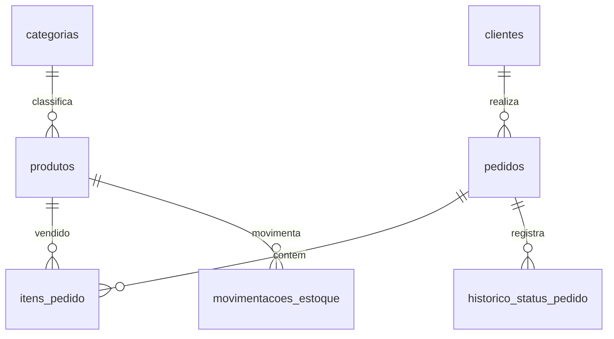

# Estrutura do banco

## Pedidos e valores

`pedidos` armazena cliente, data, status, desconto e frete. `itens_pedido` guarda produto, quantidade e preço unitário no momento da compra. O subtotal é calculado a partir dos itens e o total é `subtotal - desconto + frete`; não há total duplicado salvo no pedido.

Desconto e frete usam `NUMERIC(10,2)`, com padrão zero. A função `registrar_pedido` valida a lista de itens, bloqueia os produtos em ordem de ID, verifica estoque e valores e grava pedido, itens e saídas em uma única transação. Ela retorna o ID criado. O procedimento `registrar_venda` mantém a interface anterior para um único produto.

`cancelar_pedido` bloqueia o pedido, exige status concluído, muda para cancelado e registra as entradas de todos os itens em ordem de produto. `registrar_historico_status` registra cada mudança de status.

## Estoque

`movimentacoes_estoque` guarda entradas e saídas. O trigger `atualizar_estoque` bloqueia o produto antes de validar e atualizar o saldo. Na API, novos produtos começam com saldo zero e são abastecidos pela rota de entradas. A carga fictícia contém saldos iniciais e pedidos históricos sem movimentos retroativos.

## Relatórios

- `dashboard_loja`: clientes, produtos, pedidos concluídos, faturamento com desconto/frete e estoque total.
- `pedidos_detalhados`: itens com seus subtotais e o total do pedido repetido por linha.
- `relatorio_vendas`: valores brutos dos itens, sem rateio de desconto/frete.
- `produtos_estoque_baixo`: produtos no limite de estoque informado.

## Instalação e evolução

`sql/00_setup.sql` instala tudo em um banco vazio, em uma transação. `migrations/001_pedidos_multiplos.sql` atualiza uma instalação completa da versão anterior preservando dados. A migração deve ser aplicada uma única vez e não faz parte das instruções para bancos novos.
